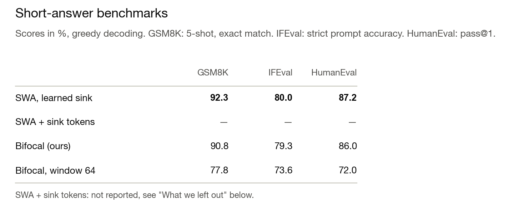

## TL;DR

- A recent paper, [Sliding-window beats linear attention](https://arxiv.org/abs/2608.28444), shows that sliding window attention (SWA) with attention sinks matches or beats most linearized models.
- Based on our work on [attention linearization](https://arxiv.org/abs/2603.15590), we ran a clean ablation to test this. For short answers, our results agree.
- We distilled [Qwen3-4B-Instruct](https://huggingface.co/Qwen/Qwen3-4B-Instruct-2507) into four students with the same memory requirements per attention layer: two SWA students, one with learned sinks and one with sink tokens, and two students with our **Bifocal** layer, which spends part of the memory on a linear mixer next to a smaller sliding window.
- On math problems that need long answers (from AIME and HMMT), Bifocal solves almost twice as many as SWA. The sliding window still matters, though. When Bifocal gives almost all of its memory to the linear mixer, the math scores collapse.
- The Bifocal layer is cheap to run. In a Qwen3.5-4B-sized model where Bifocal replaces all attention and GDN layers, our fused kernels keep decoding at about 195 tokens/s for prompts up to 128K tokens, as fast as SWA in the same place and at the same memory.

## The KV cache bottleneck

A transformer stores a key and a value for every token it has seen, in every attention layer. This KV cache grows with every token the model generates. For Qwen3-4B each token uses about 144 KiB, so one 10,000-token answer needs about 1.4 GiB. In a realistic serving setting, where multiple requests are processed at once, this can quickly exceed the available GPU memory. Reasoning models write answers this long all the time, so the KV cache becomes the bottleneck.

There are two ways to keep memory fixed: you can forget old tokens and only keep the last W tokens, which is what sliding window attention does. Or you can compress them into a fixed-size state, as in linear attention and its gated successors (Mamba, Gated DeltaNet (GDN), mLSTM).

## Forget or compress

**A sliding window** is exact over the last W tokens and sees older tokens only indirectly through earlier layers. When retrofitting a pretrained model, SWA collapses as soon as the initial tokens leave the window, because attention heads use them to park spare probability mass. The fix is an *attention sink*, as proposed by [StreamingLLM](https://arxiv.org/abs/2309.17453), which pins the first four tokens in the cache. Keeping those initial tokens around, however, complicates cache management and rules out standard sliding-window kernels. Instead, we use a *learned sink* as in [gpt-oss](https://arxiv.org/abs/2508.10925), which is a learned bias in each head's softmax denominator that absorbs unused attention without storing extra tokens in the cache. This idea goes back to Evan Miller's [Attention Is Off By One](https://www.evanmiller.org/attention-is-off-by-one.html).

**A linear mixer** compresses all past tokens into a fixed-size state. In linearization, where a pretrained transformer is converted into a cheaper student, a linear mixer alone does not work well. The teacher's attention leans heavily on the last few hundred tokens and needs them at full resolution. In [our distillation paper](https://arxiv.org/abs/2603.15590), pairing the mLSTM with a sliding window uniformly lowered cross-entropy loss by restoring exact short-range recall. [LoLCATs](https://arxiv.org/abs/2410.10254) and other linearization methods add a window for the same reason.

We run both, sliding window and linear mixer, side by side in place of every attention layer. LoLCATs already distilled into a similar layer structure, and we change two things:

1. Our linear mixer is an [mLSTM](https://arxiv.org/abs/2405.04517). The argument should hold for other modern linear mixers too, such as Mamba or GDN.
2. We combine the two outputs using a data-dependent gate per head: a linear projection of the layer input to one sigmoid-activated scalar o per head, which mixes the two as o · mLSTM + (1 − o) · SWA.

We call this layer **Bifocal**: like bifocal glasses, it sees what is near sharply and what is far at lower resolution. **But is this added complexity actually necessary? Isn't it better to just spend the linear mixer's memory on a larger sliding window?**

## The case for sliding windows

[Sliding-window beats linear attention](https://arxiv.org/abs/2608.28444) argues that a sliding window with sinks is enough on its own. Without any training, a 64-token window with four sink tokens recovers 99% of the teacher's score on six standard benchmarks. With a 512-token window, it has the best average on GSM8K and HumanEval among the training-free and linearized methods tested, and it beats retrofitted linear models by a wide margin on needle-in-a-haystack and BABILong.

We agree that SWA with sinks is a strong, cheap baseline, and every linearization paper should report it. Three things in the setup, though, limit how far the conclusion reaches:

- Most linear models in the generative and long-context comparisons were retrofitted on small budgets, 20 to 600 million tokens.
- "Long context" there means long *inputs* with short answers. None of the benchmarks require the model to write a long answer.
- Much of the comparison runs on log-likelihood benchmarks.

The last point is a problem for the whole field. Many linearization papers report only HellaSwag, WinoGrande, PIQA, ARC and MMLU. These benchmarks score a few fixed answer options in a single forward pass, and the model never reads anything it wrote itself. If a 64-token window recovers 99% on them, they cannot tell you whether a model remembers anything far back.

To address all three points, and follow up on the SWA paper's own suggestion to compare post-trained SWA against linear retrofitting at equal training budgets, we distill both architectures on the same 4B-token budget, match their inference memory, and evaluate them on benchmarks that require generating both short and long answers.

## A memory-matched comparison

We initialize all students from [Qwen3-4B-Instruct](https://huggingface.co/Qwen/Qwen3-4B-Instruct-2507), replacing all 36 of its attention layers. The model uses grouped-query attention with 32 query heads sharing 8 key-value heads.

To match memory across students, we express the linear mixer's state in equivalent BF16 KV cache tokens. Without softmax, [linear attention](https://arxiv.org/abs/2006.16236) can be trained in a fast parallel form (like a transformer) and unrolled at inference into a recurrent state that accumulates outer key-value products. Because this recurrent state sums over thousands of steps, it must be kept in FP32 to avoid numerical drift from the parallel training form. So one 128 × 128 mLSTM state takes as much memory as 128 cached tokens of a BF16 key-value head. Because there are four query heads for every key-value head, it also matters where the states live: keeping one state per key-value head costs 128 tokens of window per layer, whereas keeping one per query head costs 512.

That lets us give four students exactly the same budget, the memory of 576 cached tokens per layer:

- **SWA, learned sink:** a 576-token window with the same learned sinks as Bifocal.
- **SWA + sink tokens:** a 572-token window plus the 4 sink tokens of StreamingLLM, as in the SWA paper.
- **Bifocal:** a 448-token window plus one state per key-value head, worth 128 tokens, and learned sinks, which take no cache.
- **Bifocal, window 64:** a 64-token window plus one state per query head, worth 512 tokens.

All four students are distilled with the same data, recipe, and 4.1-billion-token budget on sequences up to 40K tokens. This makes the SWA students much stronger baselines than training-free SWA, with every chance to learn to pass information across their 36 stacked windows (more on how far stacked windows actually reach below).

Our main comparison is SWA with a learned sink against Bifocal: since a learned scalar sink per head takes negligible memory, both use the exact same cache budget and differ only in how they spend it. We also trained an SWA student with pinned sink tokens to check whether the sink type matters—on the math benchmarks (AIME and HMMT), it doesn't, with both SWA variants scoring around 14%.

### Sliding window alone is enough for short answers

On short answers, a larger window is as good as a state, or slightly better. The SWA student is ahead on all three short benchmarks, by 0.7 to 1.5 points. When answers are only a few hundred tokens long, the prompt and response mostly fit inside the window anyway, so the model rarely needs to fall back on a compressed state. SWA also has a head start in distillation as it keeps the teacher's architecture and only changes the attention mask and adds a sink, while Bifocal has to learn a new linear mixer and gate. So in this regime, our results agree with the SWA paper.

### The linear mixer helps on long answers

Hard math is different. On AIME and HMMT, our students write about 7,600 tokens per answer. At any step, the window only covers about 8% of that. After a few hundred tokens of reasoning, the question itself has left the window, and as the answer grows, intermediate results from earlier steps leave it too. The linear mixer's state still holds a summary of all of it.

Bifocal is ahead on all four math benchmarks, but by small margins: 15.5% against 13.8% on average. With only 120 problems, this gap is right at the edge of statistical significance. The picture gets much clearer when we group the problems by how long their answers are.

On problems with short answers, both solve about 59%. On the 96 with long answers, Bifocal solves 1.8 times as many, and the SWA student with sink tokens does no better. Looking across all individual rollouts, Bifocal produces 66 correct answers longer than 4,000 tokens, compared to just 26 for the SWA student. Long answers are where the sliding window struggles and where the state helps.

<aside class="note">

**Can't stacked sliding window layers see further?**

A common argument for pure sliding window attention is that each layer passes information on to the next, so L stacked windows of W tokens can reach L × W tokens back, like stacked convolutions. This was introduced by [Longformer](https://arxiv.org/abs/2004.05150) in 2020 and popularized by [Mistral 7B](https://arxiv.org/abs/2310.06825), which noted that 32 layers with 4,096-token windows give "a theoretical attention span of approximately 131K tokens".

For our SWA student, that theoretical reach is 36 × 576 = 20,736 tokens—longer than 88% of its answers. On paper, it can still see the question from almost anywhere in its answer, but in practice, it solves long-answer problems far less often than Bifocal.

The reason is the same as for CNNs, whose effective receptive field is a small fraction of the theoretical one ([Luo et al., 2016](https://arxiv.org/abs/1701.04128)). In a transformer, most of each token's signal stays on the residual path, and only a fraction moves through attention into the next window. Guangxuan Xiao [shows](https://guangxuanx.com/blog/stacking-swa.html) that this makes the influence of a distant token decay roughly exponentially with the number of windows in between, leaving an effective range of about 1.5 windows, regardless of depth. A linear mixer does not need this cross-layer relay: each layer's recurrent state carries earlier tokens forward directly.

</aside>

## A linear mixer alone is not enough either

If the linear state helps on long answers, it is tempting to spend almost the whole budget on it. Our fourth student, Bifocal with window 64, tests this by keeping a state per query head (512 tokens worth of memory) alongside a tiny 64-token window. Rather than improving long-range reasoning, the model collapses, scoring just 4.2% on math (vs. 15.5% for Bifocal) and falling sharply on the short-answer benchmarks as well. Exact recall over the recent past is still essential, and a compressed state blurs that information.

This also highlights a practical lesson for grouped-query attention: because there are four query heads per key-value head, putting states on query heads costs four times as much memory, directly starving the sliding window (64 tokens instead of 448).

## What does the linear mixer cost?

With memory matched by design, what about speed? We benchmarked decoding in vLLM on the Qwen3.5-4B architecture, replacing all of its attention and GDN layers with either SWA or Bifocal at a 576-token budget per layer. (Qwen3.5's key-value heads are wider, so a state costs more and Bifocal gets a 320-token window.) For comparison, we also ran full attention and Qwen3.5's native hybrid layout (GDN + attention, which pairs three GDN layers with each full-attention layer).

During decoding, Bifocal is just as fast as pure SWA. With all attention and GDN layers replaced, both hold steady at about 195 tokens/s from 1K all the way to 128K prompt tokens, staying within about 2% of each other at every length. Meanwhile, GDN + attention slows to 146 tokens/s at 128K as its full-attention caches grow with the context, and full attention drops to 92 tokens/s.

Where the linear mixer does cost time is prompt processing (prefill): Bifocal ingests prompts at 63% to 83% of SWA's speed, needing 1.8 s instead of 1.5 s before the first token of a 128K prompt. For long-form reasoning, though, where generating a 10,000-token answer takes almost a minute, that extra 0.3 s on the prompt is negligible.

## Takeaways

- **SWA with sinks is a strong, cheap baseline, and worth reporting.** On short answers, nothing in our runs beats it at equal memory.
- **Compare at equal memory.** A linear mixer's state takes memory too: count it in equivalent KV cache tokens, and keep grouped-query attention in mind when deciding whether states are shared across query heads.
- **Evaluate on long generations, and look at them by length.** Log-likelihood benchmarks and short answers cannot tell these architectures apart, and an average over all problems hides where the state helps.
- **Use both.** A window alone runs out on long answers; a linear mixer alone blurs the recent past. Bifocal combines them at the same memory and decoding speed.

More on the distillation recipe in our paper, [Effective Distillation to Hybrid xLSTM Architectures](https://arxiv.org/abs/2603.15590).

## Details

- **Models.** Teacher: Qwen3-4B-Instruct-2507. All four students replace every attention layer (36 layers). SWA, learned sink: a 576-token sliding window with a learned scalar sink per head. SWA + sink tokens: a 572-token sliding window plus the first 4 tokens of the sequence. Bifocal: a 448-token window with a learned scalar sink per head, plus an mLSTM with one state per key-value head (8 states of 128 × 128 per layer, FP32), blended by a per-head, data-dependent gate. Bifocal, window 64: the same, with a 64-token window and one state per query head (32 states per layer).
- **Memory accounting.** Per layer, one cached token takes 8 key-value heads × 128 dims × key and value × 2 bytes = 4 KiB. One FP32 state takes 64 KiB, so 8 states are worth 128 tokens and 32 states 512. The mLSTM's normalizer vectors add under 1% and are not counted.
- **Distillation.** Layer-wise hidden-state alignment (2,500 steps, 819M tokens), then logit distillation with a KL-only loss (10,000 steps, 3.28B tokens), on sequences of up to 40,960 tokens. The same for all four students.
- **Data.** Nemotron generalist mix: 40% chat and instruction, 20% code, 20% math, 15% science, 5% safety.
- **Evaluation.** AIME 2024 and 2025, HMMT February and November 2025: 30 problems each, 16 samples per problem, up to 31,744 new tokens, temperature 0.6, top-p 0.95, top-k 20, pass@1 averaged over samples. On the math benchmarks, 24% of Bifocal's rollouts and 12% of the SWA student's hit this limit, mostly by repeating a final answer they had already written. These answers are almost always wrong: crediting the few that contain the right answer would add 0.4 and 0.1 points. GSM8K: 5-shot, exact match, greedy decoding. IFEval: strict prompt accuracy, greedy decoding. HumanEval (instruct): pass@1, greedy decoding. Answer lengths are re-tokenized from the saved text with the teacher's tokenizer.
- **Statistics.** Confidence intervals come from a paired bootstrap over problems with 20,000 resamples. For Bifocal's gain on the math average, the 95% interval runs from 0.0 to 3.4 points. On the 96 long-answer problems, it runs from 0.7 to 3.3 points. For the grouping by answer length, each problem's typical length is the median over all 32 answers of the two main students. The per-answer counts grade each answer by exact match with the reference answer, which agrees with the evaluation's per-problem scores on 472 of 480 problem–student pairs.
- **What we left out.** For the SWA student with sink tokens, we report only math. Our evaluation code for sink tokens mishandles prompts longer than the cache: on GSM8K, whose 5-shot prompts are 700 to 870 tokens long, this student answered one of the example questions instead of the test question in 14% of problems, against 1% to 2% for the other students. The math prompts are under 200 tokens. GPQA Diamond's 3,072-token limit cut off 37% to 53% of the answers, so it mostly measures who finishes in time.
- **Speed.** vLLM 0.28 on one H100 80 GB, batch size 1, synthetic weights with the Qwen3.5-4B shape: 32 layers, 16 query heads and 4 key-value heads with head dimension 256. SWA and Bifocal replace all 32 attention and GDN layers; the MLPs are unchanged. Each request reads a prompt of 1K to 128K tokens and then generates 256 tokens; we report the median of five requests. SWA: a 576-token window with a learned scalar sink per head (FlashAttention-3). Bifocal: a 320-token window with the same sinks, plus one 256 × 256 FP32 mLSTM state per key-value head, with fused Triton kernels for decode and prefill. Per layer, a cached token takes 4 KiB and a state 256 KiB, so both hold 2.25 MiB, 576 tokens' worth, or 72 MiB per model. GDN + attention and the full-attention model ran earlier on another H100 with the same software versions; a recent run of GDN + attention on the same GPU as SWA and Bifocal matched it within 0.2 tokens/s at 8K and 128K. Parameters: 3.74B (SWA), 3.78B (Bifocal), 4.21B (GDN + attention).
